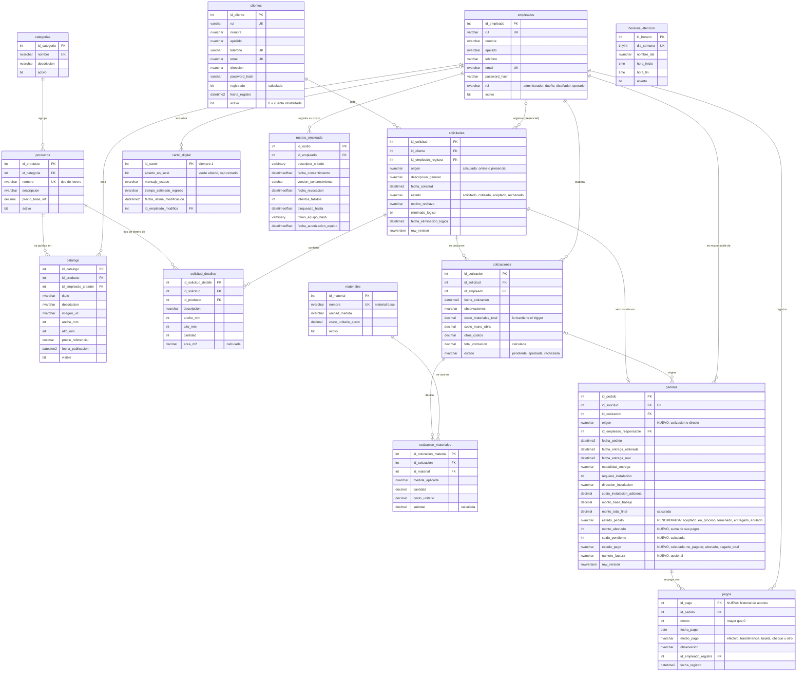
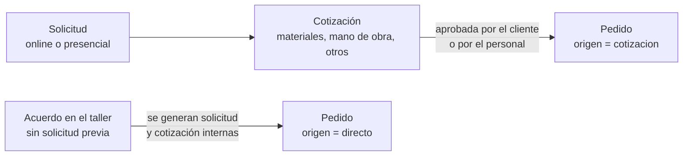
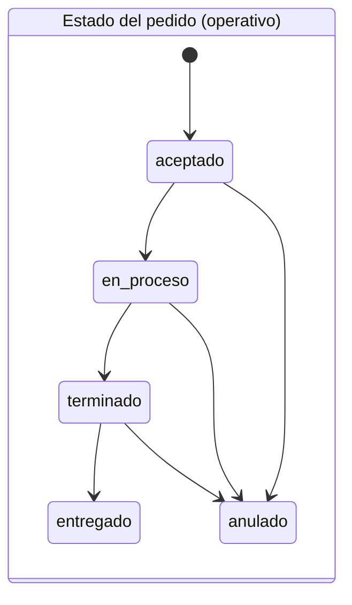
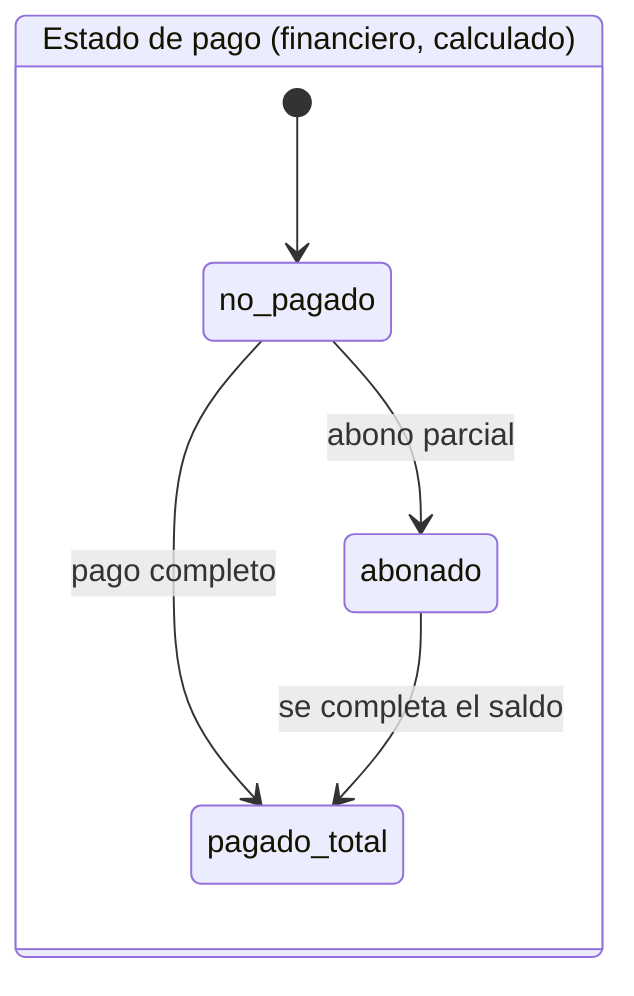

# Modelo entidad-relación — LetreriaLosHerreraDB

Estado del esquema: migración `HistorialDePagos` (12-11-2026). Fuente única del esquema: el modelo de EF Core (`LetrerosHerreradbContext.cs`) y sus migraciones. El script completo para crear la base está en [`LetreriaLosHerreraDB.sql`](LetreriaLosHerreraDB.sql) y el detalle de cada columna en el [diccionario de datos](diccionario-de-datos.md).

15 tablas, 1 vista, 2 triggers y 1 procedimiento almacenado.

## Diagrama

GitHub y Visual Studio Code dibujan este bloque como imagen. Para exportarlo a PNG o SVG se puede pegar en <https://mermaid.live>.

`horarios_atencion` no se relaciona con otras tablas: guarda el horario semanal publicado. La vista `vw_metricas_conversion_online` se calcula a partir de `solicitudes` y `pedidos`.

## Flujo de negocio que expresa el modelo

**Pedido presencial directo.** Cuando un cliente acuerda el trabajo en el taller, el personal registra el pedido de una vez. En la misma transacción se crean una solicitud presencial (con sus ítems: tipo de letrero, medidas, cantidad y glosa) y una cotización aprobada (con el material base, la mano de obra y la instalación). Así todo pedido conserva su detalle en las mismas tablas, y los reportes y las búsquedas por cliente funcionan igual para los dos orígenes. La columna `origen` del pedido los distingue.

## Estados del pedido: dos atributos independientes

Un pedido puede fabricarse y entregarse sin estar pagado, por ejemplo cuando un cliente habitual paga a fin de mes. También puede pagarse por adelantado o con un abono parcial. Por eso el estado operativo y el estado de pago son columnas distintas.

- **«Anulado» reemplaza a «cancelado»**, porque en Chile «cancelado» se entiende como «pagado».
- **Cada abono queda en `pagos`** con su monto, fecha, medio de pago y quién lo registró. El trigger `trg_pagos_recalcular_monto_abonado` mantiene `monto_abonado` igual a la suma de los pagos del pedido.
- **El estado de pago no se escribe a mano.** La base lo calcula a partir de `monto_abonado` y del monto final: sin abono es `no_pagado`, con el total cubierto es `pagado_total`, y entre ambos es `abonado`. Así nunca contradice a los montos.
- **Saldo pendiente** = monto final − monto abonado. La base impide abonar más que el monto final (`ck_pedidos_monto_abonado`): un pago que haría superarlo no se guarda.
- **Cierre del ciclo:** un pedido está cerrado solo cuando su estado es `entregado` y su pago es `pagado_total`.
- **Cobranza:** el índice `ix_pedidos_cobranza` resuelve el listado de pedidos no anulados con pago `no_pagado` o `abonado` y su saldo.
- Las transiciones del estado operativo (qué paso puede seguir a cuál) las valida la capa de negocio en la fase 8. El diagrama de arriba es la propuesta que se confirmará en la fase 7.
