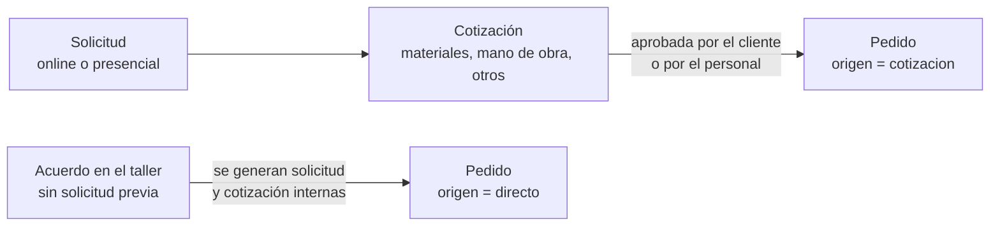
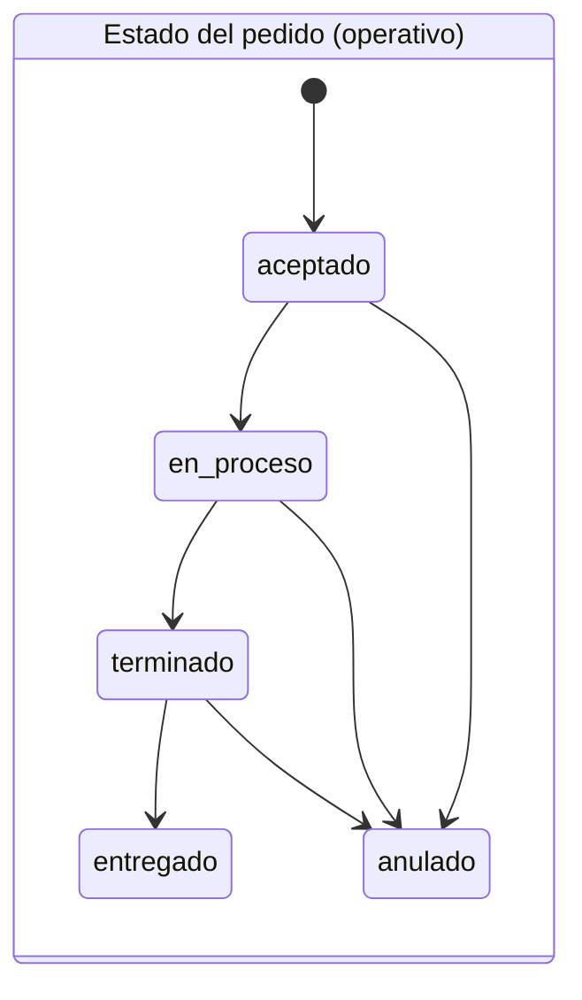
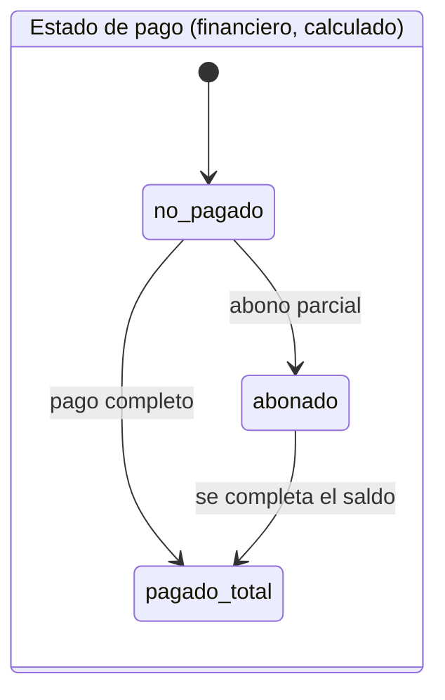
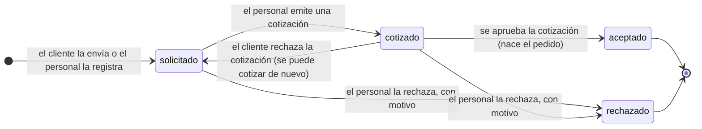
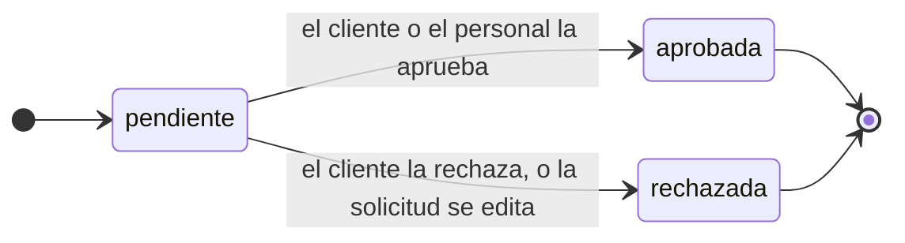

# Modelo entidad-relación — LetreriaLosHerreraDB

Estado del esquema: migración `SolicitudesYAdjuntos` (14-11-2026). Fuente única del esquema: el modelo de EF Core (`LetrerosHerreradbContext.cs`) y sus migraciones. El script completo para crear la base está en [`LetreriaLosHerreraDB.sql`](LetreriaLosHerreraDB.sql) y el detalle de cada columna en el [diccionario de datos](diccionario-de-datos.md).

23 tablas, 1 vista, 2 triggers y 1 procedimiento almacenado.

## Diagrama

```mermaid
erDiagram
    categorias ||--o{ productos : "agrupa"
    productos ||--o{ catalogo : "se publica en"
    productos ||--o{ solicitud_detalles : "tipo de letrero de"
    empleados |o--o{ catalogo : "crea"

    clientes ||--o{ solicitudes : "pide"
    empleados |o--o{ solicitudes : "registra (presencial)"
    solicitudes ||--o{ solicitud_detalles : "contiene"
    solicitudes |o--o{ adjuntos_solicitud : "tiene (vacío mientras es borrador)"
    clientes |o--o{ adjuntos_solicitud : "sube (borrador o archivo de su solicitud)"
    empleados |o--o{ adjuntos_solicitud : "sube desde la ficha"
    solicitudes ||--o{ solicitudes_historial : "registra cada cambio de estado"
    clientes |o--o{ solicitudes_historial : "cambia (envío en línea)"
    empleados |o--o{ solicitudes_historial : "cambia"

    solicitudes ||--o{ cotizaciones : "se cotiza en"
    empleados ||--o{ cotizaciones : "elabora"
    cotizaciones ||--o{ cotizacion_materiales : "detalla"
    materiales ||--o{ cotizacion_materiales : "se usa en"

    solicitudes ||--o| pedidos : "se concreta en"
    cotizaciones |o--o{ pedidos : "origina"
    empleados ||--o{ pedidos : "es responsable de"
    pedidos ||--o{ pagos : "se paga con"
    empleados ||--o{ pagos : "registra"

    empleados |o--o{ cartel_digital : "actualiza"
    empleados ||--o{ rostros_empleado : "registra su rostro"

    clientes |o--o{ consentimientos : "acepta"
    empleados |o--o{ consentimientos : "acepta"
    empleados ||--o{ imagenes : "sube"
    imagenes |o--o{ catalogo : "ilustra"
    empleados |o--o{ catalogo : "autoriza el logo"

    clientes |o--o{ tokens_renovacion : "tiene sesiones"
    empleados |o--o{ tokens_renovacion : "tiene sesiones"
    clientes |o--o{ codigos_cuenta : "recibe enlace o código"
    empleados |o--o{ codigos_cuenta : "recibe código de recuperación"

    categorias {
        int id_categoria PK
        nvarchar nombre UK
        nvarchar descripcion
        bit activo
    }
    productos {
        int id_producto PK
        int id_categoria FK
        nvarchar nombre UK "tipo de letrero"
        nvarchar descripcion
        decimal precio_base_ref
        bit activo
    }
    catalogo {
        int id_catalogo PK
        int id_producto FK
        int id_empleado_creador FK
        nvarchar titulo
        nvarchar descripcion
        nvarchar imagen_url "antigua, ya opcional"
        int ancho_mm
        int alto_mm
        decimal precio_referencial
        datetime2 fecha_publicacion
        bit visible
        int id_imagen FK "fase 5"
        bit incluye_logo_cliente "fase 5"
        int id_empleado_autoriza_logo FK "fase 5"
        datetimeoffset fecha_autorizacion_logo "fase 5"
    }
    clientes {
        int id_cliente PK
        varchar rut UK
        nvarchar nombre
        nvarchar apellido
        varchar telefono UK
        nvarchar email UK
        nvarchar direccion
        varchar password_hash
        bit registrado "calculada"
        datetime2 fecha_registro
        bit activo "0 = cuenta inhabilitada"
        datetimeoffset fecha_verificacion_correo "nulo = sin confirmar"
    }
    empleados {
        int id_empleado PK
        varchar rut UK
        nvarchar nombre
        nvarchar apellido
        varchar telefono
        nvarchar email UK
        varchar password_hash
        nvarchar rol "administrador, dueño, diseñador, operario"
        bit activo
    }
    solicitudes {
        int id_solicitud PK
        int id_cliente FK
        int id_empleado_registra FK
        nvarchar origen "calculada: online o presencial"
        nvarchar descripcion_general "hasta 2000"
        datetime2 fecha_solicitud
        nvarchar estado "solicitado, cotizado, aceptado, rechazado"
        nvarchar motivo_rechazo
        bit eliminado_logico
        datetime2 fecha_eliminacion_logica
        char huella_ip "HMAC de la IP; nunca la IP"
        rowversion row_version
    }
    solicitud_detalles {
        int id_solicitud_detalle PK
        int id_solicitud FK
        int id_producto FK
        nvarchar descripcion
        int ancho_mm
        int alto_mm
        int cantidad
        decimal area_m2 "calculada"
    }
    solicitudes_historial {
        int id_historial PK
        int id_solicitud FK
        nvarchar estado_anterior "nulo al crearse"
        nvarchar estado_nuevo
        nvarchar motivo "hasta 500"
        int id_empleado FK "o"
        int id_cliente FK "o"
        datetimeoffset fecha
    }
    adjuntos_solicitud {
        int id_adjunto PK
        int id_solicitud FK "nulo mientras es borrador"
        int id_cliente FK "o"
        int id_empleado FK "o"
        char clave UK "aleatoria, nombre del archivo en disco"
        varchar tipo "imagen o pdf"
        nvarchar nombre_original "saneado, hasta 120"
        int bytes
        int ancho "solo imagenes"
        int alto "solo imagenes"
        datetimeoffset fecha_subida
        datetimeoffset fecha_vinculo "presente si hay solicitud"
    }
    materiales {
        int id_material PK
        nvarchar nombre UK "material base"
        nvarchar unidad_medida
        decimal costo_unitario_aprox
        bit activo
    }
    cotizaciones {
        int id_cotizacion PK
        int id_solicitud FK
        int id_empleado FK
        datetime2 fecha_cotizacion
        nvarchar observaciones
        decimal costo_materiales_total "lo mantiene el trigger"
        decimal costo_mano_obra
        decimal otros_costos
        decimal total_cotizacion "calculada"
        nvarchar estado "pendiente, aprobada, rechazada"
    }
    cotizacion_materiales {
        int id_cotizacion_material PK
        int id_cotizacion FK
        int id_material FK
        nvarchar medida_aplicada
        decimal cantidad
        decimal costo_unitario
        decimal subtotal "calculada"
    }
    pedidos {
        int id_pedido PK
        int id_solicitud FK "UK"
        int id_cotizacion FK
        nvarchar origen "NUEVO: cotizacion o directo"
        int id_empleado_responsable FK
        datetime2 fecha_pedido
        datetime2 fecha_entrega_estimada
        datetime2 fecha_entrega_real
        nvarchar modalidad_entrega
        bit requiere_instalacion
        nvarchar direccion_instalacion
        decimal costo_instalacion_adicional
        decimal monto_base_trabajo
        decimal monto_total_final "calculada"
        nvarchar estado_pedido "RENOMBRADA: aceptado, en_proceso, terminado, entregado, anulado"
        int monto_abonado "NUEVO, suma de sus pagos"
        int saldo_pendiente "NUEVO, calculada"
        nvarchar estado_pago "NUEVO, calculada: no_pagado, abonado, pagado_total"
        nvarchar numero_factura "NUEVO, opcional"
        rowversion row_version
    }
    pagos {
        int id_pago PK "NUEVA: historial de abonos"
        int id_pedido FK
        int monto "mayor que 0"
        date fecha_pago
        nvarchar medio_pago "efectivo, transferencia, tarjeta, cheque u otro"
        nvarchar observacion
        int id_empleado_registra FK
        datetime2 fecha_registro
    }
    horarios_atencion {
        int id_horario PK
        tinyint dia_semana UK
        nvarchar nombre_dia
        time hora_inicio
        time hora_fin
        bit abierto
    }
    cartel_digital {
        int id_cartel PK "siempre 1"
        bit abierto_en_local "verde abierto, rojo cerrado"
        nvarchar mensaje_estado
        nvarchar tiempo_estimado_regreso
        datetime2 fecha_ultima_modificacion
        int id_empleado_modifica FK
    }
    rostros_empleado {
        int id_rostro PK
        int id_empleado FK
        varbinary descriptor_cifrado
        datetimeoffset fecha_consentimiento
        varchar version_consentimiento
        datetimeoffset fecha_revocacion
        int intentos_fallidos
        datetimeoffset bloqueado_hasta
        varbinary token_equipo_hash
        datetimeoffset fecha_autorizacion_equipo
    }
    consentimientos {
        int id_consentimiento PK
        int id_cliente FK "o"
        int id_empleado FK "o"
        varchar referencia_envio "o, visitante sin cuenta"
        varchar tipo "privacidad, terminos, marketing, cookies"
        varchar version_documento
        datetimeoffset fecha_aceptacion
        datetimeoffset fecha_revocacion
    }
    imagenes {
        int id_imagen PK
        char clave UK "aleatoria, nombre de los archivos"
        int ancho
        int alto
        int bytes_grande
        int bytes_miniatura
        bit es_ejemplo "fase 5"
        int id_empleado_sube FK
        datetimeoffset fecha_subida
    }
    consultas_contacto {
        int id_consulta PK
        nvarchar nombre "hasta 100"
        nvarchar correo "hasta 254"
        nvarchar telefono "opcional, +56"
        nvarchar asunto "hasta 150"
        nvarchar mensaje "hasta 2000"
        datetimeoffset fecha_recepcion
        bit revisada
        datetimeoffset fecha_revision
    }
    tokens_renovacion {
        bigint id_token PK
        int id_cliente FK "o"
        int id_empleado FK "o"
        char hash_token UK "SHA-256 del token"
        uniqueidentifier familia "un inicio de sesión"
        datetimeoffset fecha_creacion
        datetimeoffset fecha_expiracion
        datetimeoffset fecha_uso
        datetimeoffset fecha_revocacion
    }
    codigos_cuenta {
        bigint id_codigo PK
        int id_cliente FK "o"
        int id_empleado FK "o"
        varchar proposito "verificacion_correo, recuperacion"
        char hash_codigo "HMAC o SHA-256"
        nvarchar correo
        datetimeoffset fecha_expiracion
        datetimeoffset fecha_uso
        int intentos
    }
    correos_salientes {
        bigint id_correo PK
        varchar tipo
        varchar referencia "por ejemplo solicitud:123"
        nvarchar destinatarios
        nvarchar asunto
        varchar estado "pendiente, enviando, enviado, fallido"
        int intentos
        datetimeoffset proximo_intento
        nvarchar ultimo_error
    }
```

GitHub y Visual Studio Code dibujan este bloque como imagen. Para exportarlo a PNG o SVG se puede pegar en <https://mermaid.live>.

`horarios_atencion` no se relaciona con otras tablas: guarda el horario semanal publicado. `correos_salientes` tampoco: es la cola de salida del correo, y cada fila dice a qué se refiere en `referencia`. `consultas_contacto` tampoco: es la bandeja del formulario de contacto de la portada, y su consentimiento de privacidad queda en `consentimientos` con la referencia `contacto:{id}`. La vista `vw_metricas_conversion_online` se calcula a partir de `solicitudes` y `pedidos`.

`adjuntos_solicitud` guarda los logos y diseños que acompañan a una solicitud. Mientras no tiene solicitud es un borrador del cliente, y se vincula al enviarla. Sus archivos son privados (carpeta `Adjuntos:Carpeta`, fuera del repositorio). `solicitudes_historial` guarda cada cambio de estado de una solicitud, con quién lo hizo: un empleado, el cliente o, si ninguno, el sistema.

`tokens_renovacion` y `codigos_cuenta` son de la cuenta: cada fila pertenece a un cliente o a un empleado, nunca a los dos, y se borran con su titular. `clientes.fecha_verificacion_correo` dice si el correo del cliente está confirmado.

## Flujo de negocio que expresa el modelo

**Pedido presencial directo.** Cuando un cliente acuerda el trabajo en el taller, el personal registra el pedido de una vez. En la misma transacción se crean una solicitud presencial (con sus ítems: tipo de letrero, medidas, cantidad y glosa) y una cotización aprobada (con el material base, la mano de obra y la instalación). Así todo pedido conserva su detalle en las mismas tablas, y los reportes y las búsquedas por cliente funcionan igual para los dos orígenes. La columna `origen` del pedido los distingue.

## Estados del pedido: dos atributos independientes

Un pedido puede fabricarse y entregarse sin estar pagado, por ejemplo cuando un cliente habitual paga a fin de mes. También puede pagarse por adelantado o con un abono parcial. Por eso el estado operativo y el estado de pago son columnas distintas.

- **«Anulado» reemplaza a «cancelado»**, porque en Chile «cancelado» se entiende como «pagado».
- **Cada abono queda en `pagos`** con su monto, fecha, medio de pago y quién lo registró. El trigger `trg_pagos_recalcular_monto_abonado` mantiene `monto_abonado` igual a la suma de los pagos del pedido.
- **El estado de pago no se escribe a mano.** La base lo calcula a partir de `monto_abonado` y del monto final: sin abono es `no_pagado`, con el total cubierto es `pagado_total`, y entre ambos es `abonado`. Así nunca contradice a los montos.
- **Saldo pendiente** = monto final − monto abonado. La base impide abonar más que el monto final (`ck_pedidos_monto_abonado`): un pago que haría superarlo no se guarda.
- **Cierre del ciclo:** un pedido está cerrado solo cuando su estado es `entregado` y su pago es `pagado_total`.
- **Cobranza:** el índice `ix_pedidos_cobranza` resuelve el listado de pedidos no anulados con pago `no_pagado` o `abonado` y su saldo.
- Las transiciones del estado operativo (qué paso puede seguir a cuál) las valida la capa de negocio en la fase 8. El diagrama de arriba es el que aprobó el plan de la fase 7.

## Estados de la solicitud y de la cotización (fase 7)

Diagramas aprobados en el plan de la fase 7 (`docs/plan/fase-07-plan.md`, 14-11-2026). La API aplica las transiciones de la solicitud en `Negocio/Solicitudes/ReglasSolicitud.cs` (`TransicionesSolicitud`). Las de la cotización se aplican en la fase 8.

### Solicitud

- **Quién cambia cada estado.** El personal rechaza una solicitud con motivo, de 10 a 500 caracteres, y puede devolver una «cotizado» a «solicitado». El sistema pasa a «cotizado» y a «aceptado» al emitir y aprobar una cotización (fase 8). El diagrama aprobado muestra la vuelta a «solicitado» solo para el cliente; la API también la permite al personal (`PATCH /solicitudes/{id}/estado`), que además la hace sola al editar una cotizada.
- **Edición:** los datos y los ítems solo cambian en «solicitado» o «cotizado». Editar en «cotizado» deja la cotización vigente como «rechazada» y la solicitud vuelve a «solicitado».
- **Borrado:** es lógico (la fila se conserva), solo en «solicitado» o «rechazado», y sin pedido.
- **Transición inválida:** responde `409` con `transicion_invalida` y una explicación (por ejemplo, «Una solicitud «rechazado» ya no cambia de estado.»).
- **Historial:** cada transición escribe una fila en `solicitudes_historial`, con quién la hizo y cuándo.

### Cotización

- **Varias por solicitud, una pendiente a la vez.** Las anteriores quedan como historial. La regla está fijada, pero la base todavía no impide tener dos pendientes: lo aplica la fase 8.
- **Cuándo queda rechazada una pendiente:** también al rechazar o devolver la solicitud, además de cuando el cliente la rechaza o la solicitud se edita. La API ya lo hace en esos casos.
- **Edición:** una cotización aprobada o rechazada ya no se edita.
- **Pedido y pago:** siguen la propuesta de las secciones anteriores. Se programan en la fase 8.
