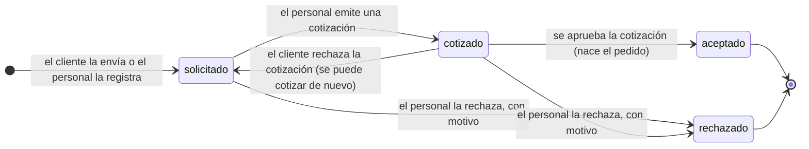
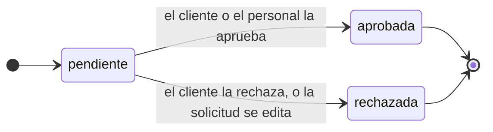

# Plan de la fase 7 — Solicitudes y clientes

Fecha: 14-11-2026 · Rama: `fase-07-solicitudes-y-clientes` · Estado: **propuesta, esperando tu aprobación**

Requisitos del plan general: RFS04 (con la regla contra solicitudes falsas), RFS03 (destino al ingresar), RFS09, RFS12, RNFP32, RNFP33, RNFO04, RNFP02, RNFP10, RFU06, RFU10, RFU11, RFU19, E03–E05, S03, S05, S25. Se suman dos pedidos tuyos del 14-11-2026: **diseños adjuntos** y **avisos por correo de cada solicitud**.

## 1. Diagramas de estados (para confirmar antes de programar)

### Solicitud

- **Edición:** se pueden editar los datos e ítems solo en «solicitado» y «cotizado». Editar en «cotizado» deja la cotización vigente como rechazada y la solicitud vuelve a «solicitado».
- **Rechazo:** exige un motivo; queda registrado quién y cuándo.
- **Borrado:** es lógico (no desaparece de la base) y solo en «solicitado» o «rechazado».
- **Transición inválida:** responde 409 con la explicación.

### Cotización

- **Varias cotizaciones por solicitud:** sí, pero **una sola «pendiente» a la vez**; las anteriores quedan como historial.
- **Edición:** una cotización aprobada o rechazada ya no se edita.
- **Fase 8:** el editor de cotizaciones y el pedido llegan en la fase 8. Aquí solo se fijan las reglas para no rehacerlas.

### Pedido y pago
Siguen la propuesta ya documentada en `docs/base-de-datos/modelo-entidad-relacion.md`. El pedido nace al aprobar la cotización y el pago se calcula de los abonos; se programa en la fase 8.

## 2. Solicitud del cliente

- **Quién la envía:** el envío en línea exige cuenta con **correo confirmado** (fase 6). Sin confirmar, el formulario explica cómo hacerlo y ofrece «Reenviar enlace».
- **Ítems:** tipo de letrero, ancho y alto (cm), área calculada y cantidad. Se pueden agregar varios; además va la descripción general.
- **Regla contra solicitudes falsas (RFS04, RNFP33):** si la cuenta, el RUT o la IP tiene una solicitud en línea pendiente o superó el límite, **no se escribe nada** y se muestra el aviso de contacto directo (horario, cartel, teléfono, WhatsApp). El aviso es igual para todos los motivos y no revela datos de terceros.
- **Comprobante:** número, fecha y hora de Chile, cliente, ítems con medidas, área y cantidad, archivos adjuntos y estado. Es el mismo en la pantalla, en el correo del cliente y en el registro presencial.

## 3. Diseños adjuntos (pedido del 14-11-2026)

- **Cuánto se puede adjuntar:** hasta **5 archivos por solicitud**, de hasta **10 MB** cada uno, para la solicitud completa.
- **Formatos:**
  - **Imágenes JPG, PNG y WebP:** se convierten a WebP sin metadatos (se borra, por ejemplo, la ubicación GPS) y con miniatura.
  - **PDF:** se reconoce por su contenido, no por el nombre, y se guarda tal cual.
  - **SVG, AI y similares:** no se aceptan, porque pueden llevar código. El mensaje pide exportarlos a PDF o PNG.
- **Cómo se ve:**
  - Una zona «Adjunta tu logo o diseño» que acepta arrastrar o elegir archivos, y abre la cámara o la galería en el teléfono.
  - Cada archivo cargado aparece como una **miniatura cuadrada del mismo tamaño para todos**. Un PDF se ve como una tarjeta del mismo tamaño, con su ícono y su nombre.
  - Cada uno tiene un botón **«×» para quitarlo**, con nombre accesible, por ejemplo «Quitar logo.png».
  - Se muestra el progreso de la subida y el contador «2 de 5», y al llegar a 5 se desactiva la zona.
  - Los errores salen por archivo («demasiado grande», «formato no aceptado»), sin perder los demás.
- **Cómo funciona:**
  - Cada archivo se sube al elegirlo y queda como **borrador del cliente**; al enviar la solicitud, se vincula a ella dentro de la misma transacción.
  - Los borradores no enviados se borran solos a las 24 horas.
- **Privacidad:**
  - Los adjuntos **no son públicos**, a diferencia de las fotos de la vitrina.
  - Solo los ven el cliente dueño y el personal, a través de una ruta que exige sesión.
  - Los nombres de archivo son aleatorios, y los PDF se descargan como adjunto.
- **Personal:** en la bandeja y en la ficha de la solicitud se ven en miniatura y se abren en grande. El registro presencial también permite adjuntar.
- **Base de datos:** tabla nueva `adjuntos_solicitud`, con la solicitud (vacía mientras es borrador), el cliente dueño, la clave del archivo, el tipo, el nombre original saneado, el tamaño, las medidas (si es imagen) y las fechas de subida y vínculo. La migración solo agrega.
- **Diseño:** pasan por ui-ux-pro-max (estados y accesibilidad), impeccable (crítica y pulido) y apple-design o animate (la entrada de cada miniatura y su retiro, breves y sin rebote).

## 4. Avisos por correo (pedido del 14-11-2026)

La razón principal del sistema: el dueño se entera por Gmail de cada solicitud nueva y la abre desde el computador o el teléfono.

- **Cuándo se guarda el correo:**
  - El aviso al taller y la confirmación al cliente se escriben en la cola **dentro de la misma transacción que la solicitud**.
  - Si la solicitud no se guarda, no hay correo. Si se guarda, el aviso no se puede perder. Es más estricto que encolar después de confirmar, y cumple lo que pediste.
  - El envío real lo hace la cola de la fase 4, fuera de la petición, así que un fallo del servidor de correo no impide guardar la solicitud.
- **Aviso al taller** (`Correo:AvisosTaller`):
  - Asunto «Nueva solicitud #123 - Nombre del cliente».
  - Contenido: número, fecha y hora de Chile, origen, cliente con nombre y teléfono, ítems con medidas, área y cantidad, descripción y cuántos archivos adjuntó.
  - Un botón **«Ver solicitud»** que abre su ficha en el panel; si no hay sesión, pide ingresar y luego vuelve a ella.
  - **Los archivos no viajan en el correo**: se ven en el panel. Así no se exponen fuera del sistema ni se llena la casilla.
- **Confirmación al cliente:** el comprobante, desde la casilla automática y con el pie de «no respondas».
- **Solicitudes rechazadas por la regla contra solicitudes falsas:** no generan ningún correo.
- **Tope:** se mantiene el de 20 avisos por hora de la fase 4.
- **Pruebas:**
  - una solicitud válida genera el aviso y la confirmación;
  - una rechazada no genera ninguno;
  - un fallo del correo no impide guardar.
  - Además, una prueba de punta a punta desde la página: al Gmail del dueño si la cuenta está configurada en User Secrets (hoy lo está), y si no, contra la bandeja local, indicándolo.

## 5. Personal

- Bandeja de solicitudes con filtros por estado, origen y fecha, búsqueda, orden y paginación.
- Ficha con ítems, adjuntos, historial de estados y quién la registró.
- Registro presencial: busca al cliente por teléfono o RUT antes de crearlo.
- Listado y ficha de clientes, con aviso si otra persona modificó el registro.
- La vista principal del panel muestra las solicitudes pendientes; ahí llegan el diseñador y el operario al ingresar.
- Permisos según RFU11.

## Cierre

- Una transición inválida responde 409 con explicación.
- El flujo en línea, con un adjunto, se completa en menos de 5 minutos en un teléfono (lo cronometro yo).
- El cliente ve solo lo suyo, también sus adjuntos.
- El aviso llega al correo del taller.
- Revisiones de ECC; pruebas no vacías en la regla contra solicitudes falsas, en la privacidad de los adjuntos y en el aviso.
- Informe de la fase y trazabilidad al día.
