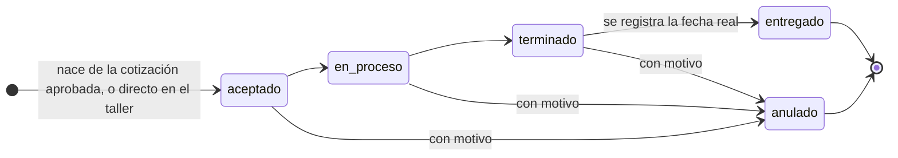

# Plan de la fase 8 — Cotizaciones, pedidos, pagos y abonos

Fecha: 14-11-2026 · Rama: `fase-08-cotizaciones-y-pedidos` (nace de `fase-07-solicitudes-y-clientes`) · Estado: **aprobado el 14-11-2026** · especificación: `fase-08-especificacion.md`

Requisitos del plan general: RFS05, RFS06, RFS04 (seguimiento del cliente), RNFO02, RNFP32, RNFP10, RFU07, RFU08, RFU12–RFU15, RFU35, RFU36, E06–E09, E25–E27, S04, S06–S08, S24.

## Lo que ya existe

- **Esquema:** el estado del pedido y el estado de pago van separados, y cada abono es una fila de `pagos`. Un trigger mantiene el monto abonado, y la base impide que supere el monto final (ajuste del 12-11-2026).
- **API:** hay rutas antiguas `/cotizaciones` y `/pedidos` que leen la base directo. No tienen filtros ni control de versión, y los permisos todavía están repartidos por rol. Se reescriben como en la fase 7: servicio, reglas, contrato y pruebas.
- **Pantallas:** las pantallas de pedidos y de pedido directo de la fase 3 filtran en el navegador. Ahora pasan a filtrar en la API.
- **Base real:** sigue sin migraciones. Como decidiste, recibe todas juntas al terminar las fases.

## 1. Estados (los aprobados en la fase 7, más el pedido)

### Pedido (independiente del pago)

- **Retrocesos:** se puede volver un paso atrás (por ejemplo, de «terminado» a «en proceso») por si alguien se equivoca. Queda en el historial.
- **Desde «entregado»:** no se avanza ni se anula.
- **Cierre del ciclo:** un pedido se cierra cuando está «entregado» **y** «pagado total», en cualquier orden. Se puede entregar sin pagar y pagar después.
- **Pago previo:** no se exige para crear el pedido (RNFO02).

### Pago (lo calcula la base)

«No pagado» → «abonado» → «pagado total», según la suma de los abonos. Nunca se escribe a mano.

## 2. Cotizaciones (RFS05, RFU12, E06, S06)

- **Editor:**
  - **Materiales:** se elige del catálogo de materiales, con la medida aplicada, la cantidad y el costo unitario (sugerido desde el material y editable).
  - **Mano de obra, otros costos y observaciones.**
  - **Totales:** el subtotal de cada línea y el total se ven en vivo, y la base los recalcula.
- **Al emitir:** la solicitud pasa a «cotizado» y queda guardado quién la elaboró.
- **Una sola pendiente por solicitud:** ahora lo garantiza la base, con un índice único filtrado (hoy es una desviación anotada).
- **Edición:** solo se edita mientras está «pendiente» y con la versión vista (If-Match). Una aprobada o rechazada queda como historial.
- **Quién cotiza:** todo el personal (RFU12). Corrige la diferencia n.º 3 de `permisos.md`, porque hoy el operario no puede.
- **Respuesta por doble vía (RFU08, E07):**
  - **El cliente** en «Mis solicitudes»: ve la cotización (S06) y la aprueba o la rechaza, con un motivo opcional.
  - **El personal**, cuando el cliente confirma por teléfono o WhatsApp. Queda registrado quién la marcó y por qué vía.
- **Si se rechaza:** la solicitud vuelve a «solicitado» y se puede cotizar de nuevo.
- **Si se aprueba:** la solicitud pasa a «aceptado» y se abre el paso a pedido.
- **Listado:** filtros por estado, fecha y cliente, con búsqueda, orden y paginación (RNFP32).

## 3. Pedidos (RFS06, RFU13, RFU14, E08, E09, S07)

- **Desde la cotización aprobada (E08):**
  - Se piden el responsable, la fecha estimada, la modalidad (retiro, despacho o instalación en terreno), si requiere instalación, la dirección y su costo, y el abono inicial si lo hay.
  - Nace «aceptado» con los montos de la cotización.
  - Todo va en una sola transacción.
  - Una cotización da a lo más un pedido, y la base lo garantiza.
- **Pedido presencial directo (RFU35, E26):**
  - Busca al cliente por RUT o teléfono, o lo crea.
  - En una transacción crea la solicitud presencial con sus ítems, la cotización aprobada, el pedido con origen «directo» y el abono, si lo deja.
  - La pantalla de la fase 3 se conecta a esa ruta.
- **Avance (E09):** cambiar el estado según el diagrama. «Entregado» pide la fecha real. Cada cambio queda en el historial del pedido, con quién y cuándo.
- **Ficha (S07):**
  - número, origen, solicitud y cotización de origen;
  - cliente, responsable, fechas, modalidad, instalación y dirección;
  - montos, estado del pedido, estado de pago, abonado, saldo y factura;
  - historial de abonos y de estados.
- **Control de versión:** editar y avanzar exigen la versión vista, y si otra persona lo cambió se avisa sin perder lo escrito (RNFP10).
- **Quién:** todo el personal crea pedidos, registra el avance y los abonos (RFU13, RFU14). Corrige la diferencia n.º 4 de `permisos.md`, porque hoy el diseñador no puede.
- **Eliminar:** solo gestión, y es lógico, como se decidió el 12-11-2026.

## 4. Abonos y pagos (E25)

- **Qué se registra:** monto, fecha de pago, medio (efectivo, transferencia, débito, crédito, cheque u otro), observación opcional y número de factura opcional del pedido. Queda quién lo ingresó y cuándo.
- **Tope:** ningún abono puede hacer superar el monto final. Lo impide la base, y la API responde con un 409 claro que indica el saldo.
- **Abonos simultáneos:** la ruta bloquea primero la fila del pedido (`UPDLOCK`), así que dos abonos al mismo tiempo se registran uno tras otro.
- **Pedido anulado:** no recibe abonos nuevos.
- **Corrección de un abono mal ingresado (decisión 2):** el abono no se edita ni se borra. Se **anula** con un motivo, queda tachado en el historial con quién y cuándo, y el trigger deja de sumarlo. Después se ingresa el correcto. Así no se pierde rastro antes de la auditoría de la fase 11.

## 5. Listados, cobranza y calendario (RFU36, E27, S24, RFU15, S08)

- **Pedidos:**
  - filtros por estado del pedido, estado de pago, cobranza, año, mes y cliente;
  - búsqueda, orden y paginación en la API;
  - los filtros quedan en la dirección, como en la bandeja de solicitudes.
- **Por cobrar (S24):** pedidos no anulados con pago «no pagado» o «abonado», con cliente, estado, monto final, abonado y saldo, y el **total por cobrar** de todo el filtro (no solo de la página).
- **Calendario de entregas (S08):**
  - vista de mes, y en el teléfono una lista por día;
  - cada pedido muestra cliente, modalidad y estado;
  - los pendientes y los entregados se distinguen con color **y** con ícono o etiqueta;
  - al tocar un pedido se abre su ficha.
- **Alertas para gestión:** en el inicio del panel, las entregas de los próximos 3 días, las atrasadas y el total por cobrar.

## 6. Seguimiento del cliente (RFU07, S04)

- **En «Mis solicitudes»:** cada solicitud muestra su número, fecha, estado y motivo si fue rechazada. Si tiene cotización, también su total y estado, con «Aprobar» y «Rechazar» mientras está pendiente.
- **Si hay pedido:** se ven el estado del pedido, el estado de pago, el saldo, la fecha estimada y la modalidad.
- **Lo que ve de la cotización:** todo lo que pide S06 (detalle de materiales, mano de obra, otros costos, total y el nombre de quien la elaboró). Solo ve lo suyo, y no ve el historial interno del pedido ni quién registró cada abono.

## 7. Migración `CotizacionesYPedidos` (solo agrega; demo, no la real)

- **Cotizaciones:**
  - `row_version` para el control de versión;
  - quién y por qué vía se respondió, la fecha de respuesta y el motivo de rechazo;
  - índice único: una sola «pendiente» por solicitud.
- **Pedidos:**
  - índice único: un pedido por cotización;
  - motivo de anulación;
  - `eliminado_logico`, también en cotizaciones.
- **Tabla nueva `pedidos_historial`:** estado anterior, estado nuevo, quién, cuándo y nota.
- **Pagos:** anulado, motivo, quién y cuándo. El trigger suma solo los no anulados.
- **Comprobaciones:** subir, revertir y volver a subir en una base temporal, y regenerar `docs/base-de-datos/LetreriaLosHerreraDB.sql`.

## 8. Pruebas y cierre

- **De punta a punta, las dos vías:**
  - solicitud → cotización → aprobación del cliente → pedido → avance → entrega;
  - pedido directo con abono.
- **Entregar sin pagar:** un pedido se entrega sin pagar y se cierra al completar el pago.
- **Tope de abonos:** ningún abono supera el monto final, ni siquiera con dos abonos simultáneos.
- **Cobranza:** el filtro de cobranza y el total por cobrar coinciden con un cálculo hecho a mano sobre datos sembrados.
- **Errores:** una transición inválida responde 409 con explicación, y una versión vieja responde 409 `version_obsoleta`, como en la fase 7.
- **Privacidad:** el cliente no ve cotizaciones ni pedidos ajenos.
- **Pruebas no vacías:** quitar el tope de abonos, la regla de una pendiente o el bloqueo del pedido hace fallar su prueba.
- **Diseño:**
  - el editor de cotización y el calendario pasan por ui-ux-pro-max (estados y accesibilidad) e impeccable (crítica y pulido);
  - Playwright con axe a 360, 768 y 1440 px.
- **Revisiones de ECC:** seguridad y C#, React y accesibilidad, y base de datos.
- **Al cerrar:** contrato, permisos, diccionario, modelo ER, trazabilidad, tablero e informe al día.

## Decisiones del usuario (14-11-2026)

1. **Montos con IVA incluido:** cada monto de la cotización y del pedido es el precio final, sin una línea de IVA aparte.
2. **Corrección de un abono:** se anula con motivo, queda tachado en el historial con quién y cuándo, deja de sumar y se registra el correcto. No se edita.
3. **Aviso de cotización lista:** el cliente recibe un correo «Tu cotización #N está lista», con el botón para verla. Sale de la cola de la fase 4, desde la casilla automática. Los demás avisos de cambio de estado (RFU09) siguen en la fase 11.
4. **Anular un pedido con abonos:** solo gestión, con motivo. La ficha muestra lo abonado como «a devolver o a favor del cliente», y la devolución no se registra en el sistema.
